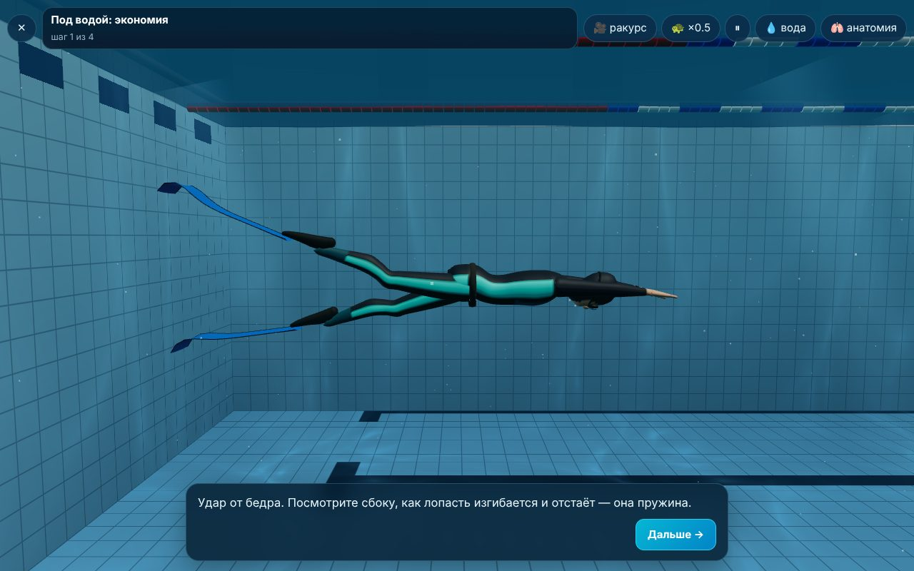
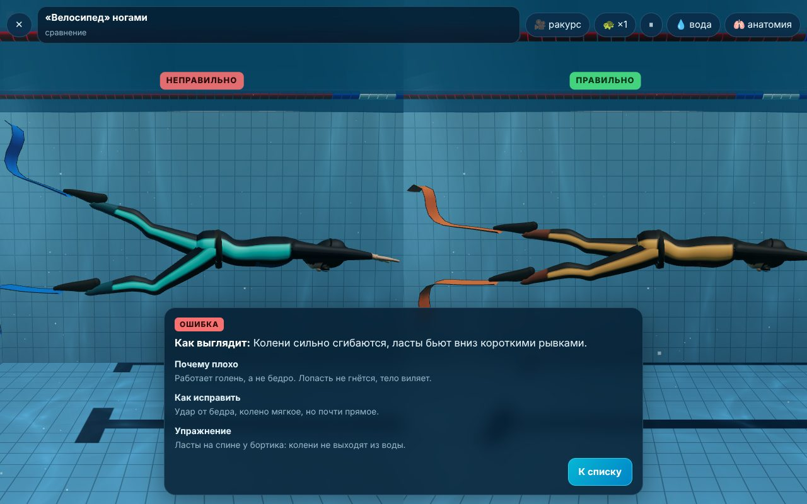
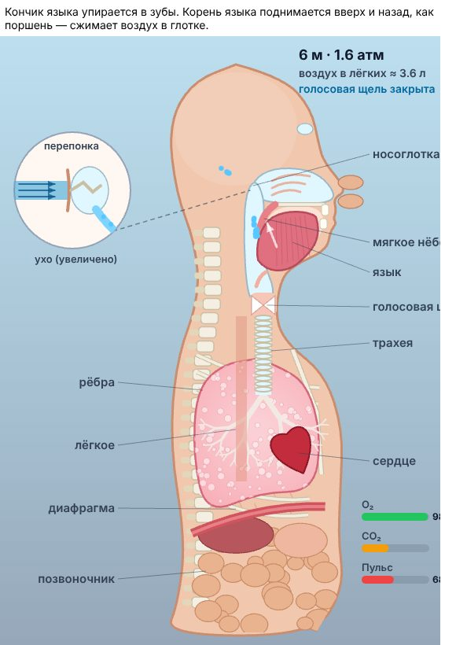

# Школа фридайвинга

Отдельное веб-приложение в этом репозитории: курс фридайвинга с 3D-ныряльщиком в бассейне, анатомией в разрезе, упражнениями, CO₂/O₂-таблицами и тренировкой дня.

**Открыть:** https://iliafreedive-del.github.io/game-rpg/freediving/





## Что внутри

- **Курс: 17 уроков в 3 модулях.** Основы (что такое фридайвинг, как мы дышим, рефлекс ныряния и позывы), базовый урок «одно ныряние целиком» (вход в воду и снаряжение, положение головы, раздышка без гипервентиляции, финальный вдох, дак-дайв, продувка ушей, экономия под водой, всплытие и протокол, работа страхующего) и техника в бассейне (ласты, моноласта, брас под водой DNF, чувство воды и скуллинг, кроль и брас). Каждый урок: теория → «фишка инструктора» → сноска «Голова» → пошаговая 3D-демонстрация с кнопкой «Дальше» → вопросы.
- **3D-ныряльщик.** Тело — гладкие поверхности из колец-сечений на скелете (скиннинг): икры, бёдра, ягодицы, грудная клетка, лопатки; пальцы из фаланг, складываются в «ОК» и зажимают нос. Гидрокостюм с капюшоном, маска, трубка, грузовой пояс, часы. Живот и рёбра дышат отдельными костями.
- **Гибкие ласты.** Лопасть — цепочка из 14 сегментов на пружинах с сопротивлением воды (тот же приём, что у паруса): гнётся, отстаёт от стопы и «выстреливает» на смене направления. Бифины и моноласта.
- **Движения:** удар ластами от бедра, волна моноластой, брас под водой (гребок — скольжение — подтянуть ноги — выброс рук и толчок), кроль с вращением корпуса и вдохом, брас на поверхности, скуллинг «восьмёркой», дак-дайв, всплытие к бортику, восстановительное дыхание и знак «ОК», разминка на бортике.
- **Чувство воды:** кнопка 💧 показывает стрелками, куда вода давит на ладони и лопасти.
- **Анатомия в разрезе (10 режимов):** раздышка животом, финальный вдох, гипервентиляция, язык и нёбо, Френзель (язык-поршень, евстахиевы трубы, перепонка в лупе), Вальсальва, погружение по закону Бойля, рефлекс ныряния, позывы, восстановительное дыхание. Воздух показан частицами, есть шкалы O₂, CO₂, пульса, глубины.
- **Библиотека ошибок (13):** два ныряльщика рядом «неправильно / правильно» в 3D или в анатомии.
- **11 упражнений в бассейне** с подходами, отдыхом, на что смотреть и безопасностью.
- **CO₂/O₂-таблицы:** расчёт от личного рекорда, тест рекорда, редактор строк, свои таблицы, таймер с кругом, звуком, вибрацией, голосом, кнопкой «Позыв», история.
- **Тренировка дня:** программы «Новичок / Любитель / Спортсмен», дни на суше и в бассейне, неделя, серия дней, прогресс.
- Телефон и компьютер, установка как приложение, офлайн (таймер у бассейна без интернета).

## Запуск локально

```
cd freediving
python3 -m http.server 8000
```

Откройте http://localhost:8000. Сборка не нужна, three.js лежит в `vendor/`.

Ссылки для проверки: `?lesson=duck&play=1&step=2`, `?mistake=bicycle`, `?exercise=sculldrill`, `?atlas=frenzel`, `?screen=tables`, `?screen=workout`.

## Безопасность

Приложение — учебное пособие и не заменяет обучение с сертифицированным инструктором. В воду — только с партнёром. Таблицы задержки — только на суше. Курс составлен по открытым знаниям о программах Molchanovs, AIDA, CMAS, PADI и физиологии апноэ; это не официальный материал этих организаций.
