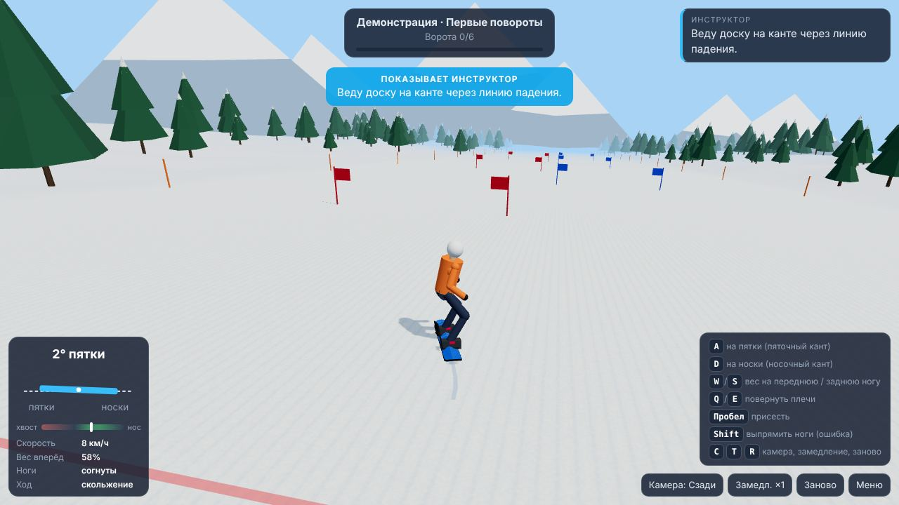
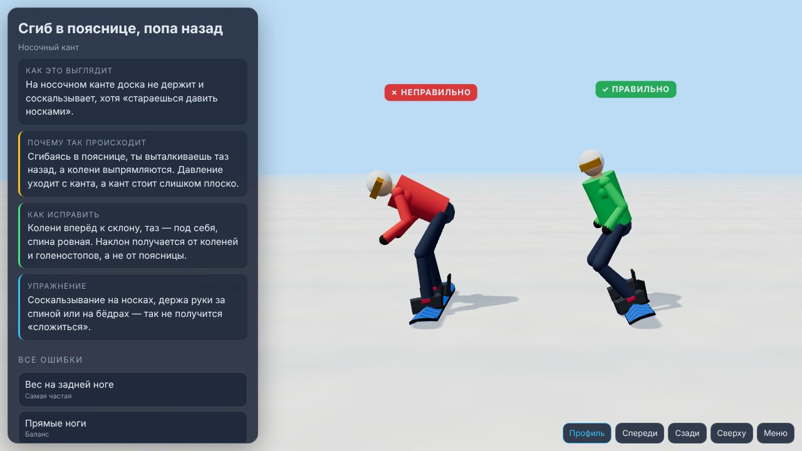

# Школа сноуборда — обучающий симулятор

Отдельный проект в этом репозитории: браузерный 3D-симулятор, который учит кататься на сноуборде понятнее, чем обучающие ролики. Стойка и крепления, базовая позиция, канты, повороты, карвинг, разбор каждого падения и библиотека типичных ошибок «неправильно / правильно». А чтобы было и просто весело — трассы на время со звёздами, рекордами и призраком лучшего заезда.




## Играть онлайн

https://iliafreedive-del.github.io/game-rpg/snowboard/ (GitHub Pages)

## Запуск локально

```
cd snowboard
python3 -m http.server 8000
```

Откройте http://localhost:8000. Нужен только статический сервер: без сборки, без интернета (three.js лежит в `vendor/`).

## Что есть

- **6 трасс на время** (зелёная → чёрная): звёзды по линии трассы, ворота слалома, финиш. На каждой трассе три звезды-задания — доехать, собрать все звёзды, уложиться во время. Звёзды открывают новые трассы и дают звания (Новичок → Легенда склона). Падение не обрывает заезд: райдер встаёт и едет дальше, а в итогах — что мешало и какой урок потренировать. Лучший заезд едет рядом призраком, в HUD — отставание от него в секундах.
- **8 уроков + свободное катание:** regular/goofy, крепления (углы, ширина, пресеты и пресеты-ошибки, вид сверху), базовая стойка (ползунки с оценкой каждого элемента), соскальзывание на пятках и на носках, падающий лист, первые повороты (слалом), мастер-класс по карвингу.
- **Каждый урок:** теория → «фишки инструктора» → демонстрация инструктора с подписями → практика с измеримой целью.
- **Разбор падений:** что произошло, почему, как исправить, упражнение и повтор последних секунд в замедлении.
- **Библиотека ошибок:** 9 ошибок, два райдера рядом в 3D, вращение камеры.
- **Панель тела:** угол канта (пятки/носки), вес хвост–нос, скорость, режим скольжения; предупреждения инструктора до падения.

Управление: A/D — кант, W/S — вес, Q/E — плечи, Пробел — присесть, Shift — прямые ноги, C — камера, T — замедление, R — заново, Esc — меню. На телефоне — экранные кнопки.

Дизайн и учебная программа: [docs/DESIGN.md](docs/DESIGN.md).

## Проверка физики без браузера

`js/sim.js` и `js/lessons.js` не зависят от графики. Автопилот-инструктор проходит все уроки на обеих стойках:

```
node tools/check-lessons.mjs
node tools/check-tracks.mjs   # трассы: финиш без падений, все звёзды, время в пределах «третьей звезды»
```
